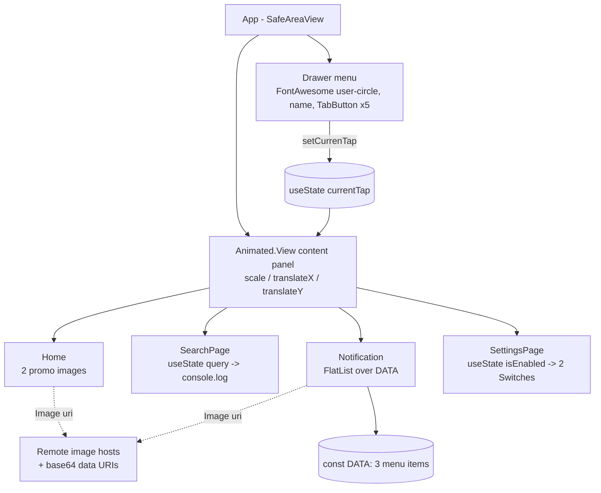

# Store

A single-file Expo app that mocks up a Thai food-ordering storefront: a purple side drawer slides the main panel aside to switch between Home (fried-chicken and sushi promos), Search, Notification (a menu/price list) and Settings.

Stack: Expo SDK 48 (`expo ~48.0.9`), React Native 0.71.4, React 18.2.0, `@expo/vector-icons` 13, `@react-navigation/native` + `bottom-tabs` 6 (installed, not wired up), `expo-status-bar`.

## What it does

| Screen / feature | What the user can do | Where in code |
|---|---|---|
| Side drawer | Tap the hamburger icon; the white content panel scales to 0.88 and slides 230 px right to reveal a purple menu with a user-circle icon, the name "Jame Moriaty", a "View Profile" link and five tabs | `App.js` – `App()`, `TabButton()` |
| Home | Scroll two large promo images with Thai captions: "ชุดไก่จุใจ" (chicken bucket set, Thairath CDN image) and "ซูชิ" (sushi, CloudFront image) | `App.js` – `Home` |
| Search | Type a query and press Search (currently logs the query, no results yet) | `App.js` – `SearchPage` |
| Notification | Browse a `FlatList` of three menu items with picture, "เมนู :" (name) and "ราคา :" (price): ข้าวมันไก่ 100, ข้าวผัด 39, ชุดไก่จุใจ 199 | `App.js` – `DATA`, `Item`, `Notification` |
| Settings | Toggle "Enable Push Notifications" and "Allow Location Access" | `App.js` – `SettingsPage` |
| Logout | Placeholder button, no action yet | `App.js` – `TabButton()` |

## Architecture

Everything lives in `App.js` (427 lines). There is no navigator: a `currentTap` string in `useState` decides which of the four page components is rendered inside an `Animated.View`, and three `Animated.Value`s (scale, translateX, close-button translateY) drive the drawer open/close transition. Each page keeps its own local `useState` (search text, switch flag); nothing is persisted and there is no AsyncStorage, Redux or Context. No HTTP calls are made from code; the only network traffic is `<Image>` fetching remote JPEG/PNG URLs from thairath.co.th, a CloudFront host, tecnogasthai.com and nestleprofessional.co.th. Two images are inlined as base64 `data:` URIs (about 26 KB of source).



## Repository layout

```
.
├── App.js               # entire app: data, 4 page components, drawer, styles
├── app.json             # Expo config: name "Store", portrait, light UI, splash/icons
├── babel.config.js      # babel-preset-expo
├── package.json         # name "store"; scripts start/android/ios/web
├── package-lock.json
├── assets/
│   ├── icon.png, adaptive-icon.png, splash.png, favicon.png   # default Expo template art
│   └── img/
│       ├── kfc.png                                   # KFC bucket promo (imported but unused)
│       └── profile-icon-login-head-icon-vector.webp  # avatar (not referenced in code)
├── .expo/               # local Expo state; committed (devices.json, README.md)
└── node_modules/        # committed by mistake, see Status
```

## Run locally

Prerequisites: Node.js 16 or 18 (Expo SDK 48 era), npm, and the Expo Go app (SDK 48 compatible) on a phone, or an iOS Simulator / Android emulator.

```sh
npm install          # or reuse the committed node_modules
npm start            # expo start -> scan the QR code with Expo Go
npm run ios          # expo start --ios
npm run android      # expo start --android
npm run web          # expo start --web
```

## Status

Learning project from 2023, built while picking up React Native and Expo. It works as a UI prototype: the drawer animation, tab switching, `FlatList`, `TextInput` and `Switch` all behave. Search only logs the query, Logout is a placeholder, and `@react-navigation` is installed but not wired in yet.

Known gaps:

- `node_modules/` and `.expo/` are committed (most of the repo's size); a `.gitignore` is the first fix.
- Promo images are hot-linked from third-party sites and may disappear.
- Both Settings switches share one state variable.

If I picked it up again: purge `node_modules/` from history, split the pages into `screens/`, use the installed bottom-tab navigator instead of the hand-rolled drawer, and back the menu list with a real API.
